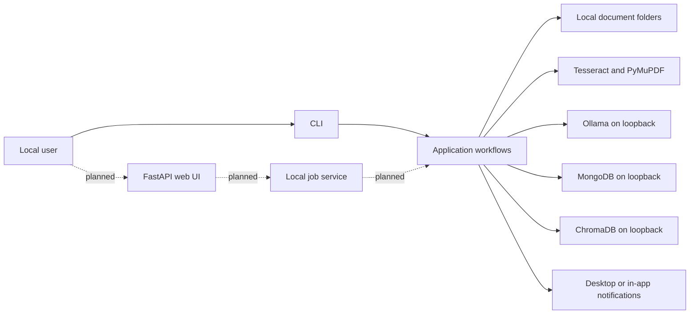

# Architecture

## Purpose and status

Smart Doc Tracker is a local document-processing application organized around typed
domain models, narrow interfaces, infrastructure adapters, and orchestration
pipelines. The command-line interface is implemented. The FastAPI web interface
described below is planned and is not available in version 0.1.0.

## System context



All arrows represent communication on the same host. No application workflow is
designed to call a remote service.

## Package responsibilities

| Package | Responsibility |
| --- | --- |
| `models` | Validated domain data and RAG result types |
| `interfaces` | Narrow protocols for replaceable dependencies |
| `core` | OCR, PDF extraction, hashing, and parsing logic |
| `infrastructure` | Local Ollama adapters and transport validation |
| `db` | MongoDB repositories and ChromaDB vector indexing |
| `notifier` | Delivery of already prepared local notifications |
| `pipeline.py` | Cross-component sequencing and workflow error policy |
| `controllers` | CLI use-case coordination and presentation decisions |
| `cli` | Argument parsing, dependency assembly, and JSON serialization |
| `inbox.py` | Supported-file discovery and collision-safe archiving |
| `scheduler.py` | Daily foreground scheduling |

Domain models do not depend on MongoDB, ChromaDB, HTTP, or the CLI. Infrastructure
adapters implement protocols from `interfaces` and are passed into workflows
explicitly.

## Document ingestion flow

1. The caller supplies a regular local file with an allow-listed extension.
2. Images are read by Pillow and Tesseract. PDFs are read page by page by PyMuPDF;
   pages without usable text use local OCR.
3. Extracted text is sent to an explicitly loopback-only Ollama endpoint.
4. Generated JSON is sanitized, checked for duplicate keys, and validated as
   `DocumentData`.
5. The source file is hashed with SHA-256.
6. MongoDB inserts the validated record only if that hash is new. Long-PDF section
   records are upserted separately.
7. ChromaDB receives local embeddings for raw-text chunks, the summary, and the
   complete structured record.
8. Inbox processing archives a successfully handled file under `data/processed`.
   A failed file remains in the inbox.

MongoDB and ChromaDB do not form a distributed transaction. A vector-index failure
after MongoDB insertion can therefore leave a stored document without a complete
index. Operational reconciliation is a required future capability.

## Query and expiration flows

For general questions, the application embeds the question locally, retrieves the
nearest Chroma fragments, and asks Ollama to produce a validated answer referencing
only retrieved document IDs. Calendar-year expiration questions use normalized
MongoDB dates directly and do not depend on semantic retrieval.

Expiration checks query an inclusive range from today through the configured number
of days. The notifier receives only a prepared document label and normalized expiry
date; it does not receive OCR text or the dynamic payload.

## Planned FastAPI application

FastAPI will be an inbound adapter over the same application services, not a place
for OCR, persistence, or business rules. The browser and API server must bind to
loopback by default.

The target modules are conceptually:

```text
src/smart_doc_tracker/
├── api/              # routes, request/response schemas, local web security
├── application/      # use cases shared by CLI and API
├── jobs/             # bounded local background-job execution and status
└── web/              # static assets or server-rendered templates
```

Document upload is long-running and should return a local job identifier. The job
state should progress through queued, extracting, parsing, storing, indexing,
completed, failed, or cancelled. Job records must not contain raw document text.
Process-local background tasks are acceptable for a single-process prototype; a
durable local queue is required before multiple workers or restart recovery are
supported.

The planned application surface includes:

- upload a supported document and inspect processing status;
- list, filter, and view validated document records;
- edit fields through the same `DocumentData` validation;
- query exact fields, expiration windows, and local RAG;
- show in-app expiration notices without placing sensitive fields in browser logs;
- delete a document through a coordinated application-level workflow.

Deletion must be implemented behind new repository and vector-index interfaces. A
single use case should remove MongoDB sections, vector fragments, the primary record,
and, only when explicitly managed by the application, the archived source file.
Failures must return a recoverable partial-deletion state or enqueue reconciliation;
routes must never issue independent best-effort deletes.

## Dependency and deployment boundaries

The current Docker Compose deployment runs MongoDB and ChromaDB with named volumes
and host ports bound to `127.0.0.1`. Ollama and Tesseract are host dependencies. The
planned FastAPI server should initially remain a host process bound to
`127.0.0.1`, keeping access to Tesseract, Ollama, desktop notifications, and managed
folders explicit.

Running multiple API workers is not supported until job ownership, scheduler
leadership, and concurrent deletion/indexing semantics are designed. One local
application process is the safe default.

## Related decisions

- [ADR 0001: Offline-first architecture](adr/0001-offline-first.md)
- [ADR 0002: Hybrid document schema](adr/0002-hybrid-document-schema.md)
- [ADR 0003: Local persistence](adr/0003-local-persistence.md)
- [ADR 0004: Local RAG](adr/0004-local-rag.md)
