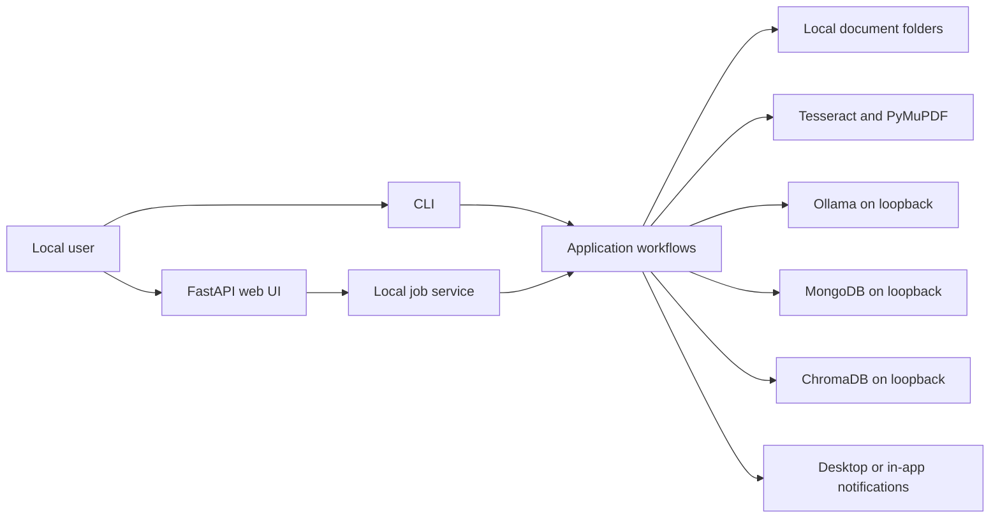
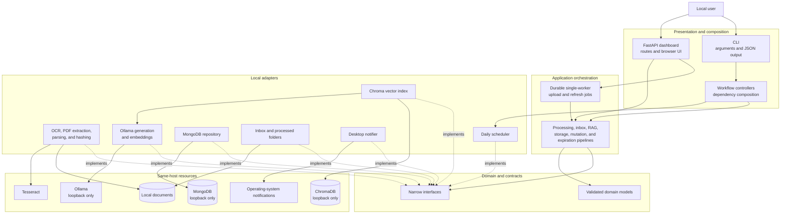
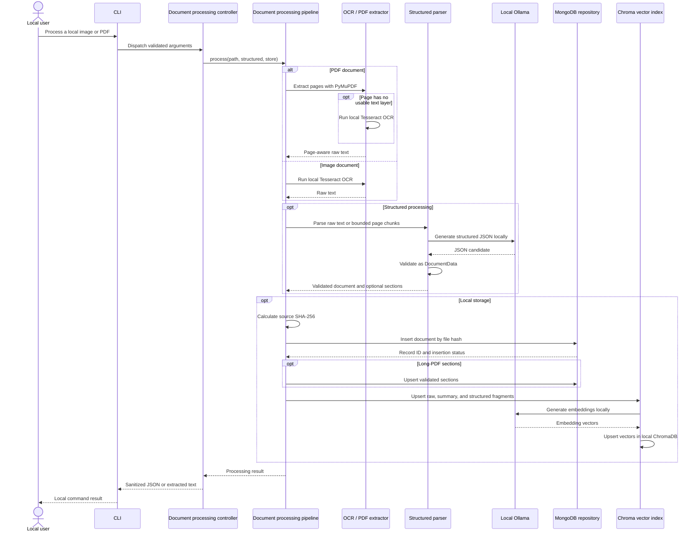
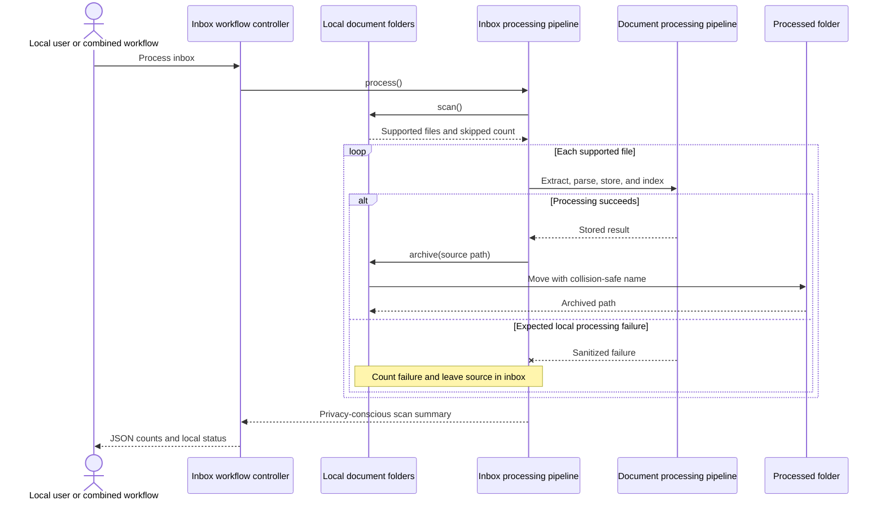
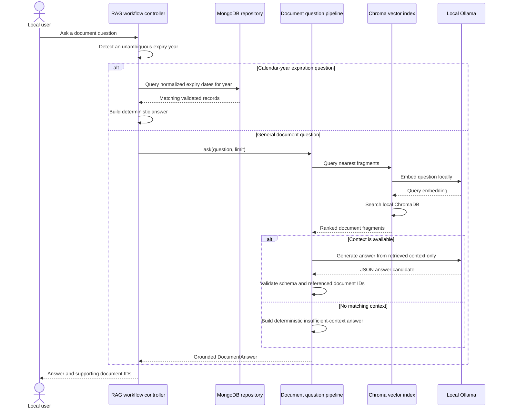
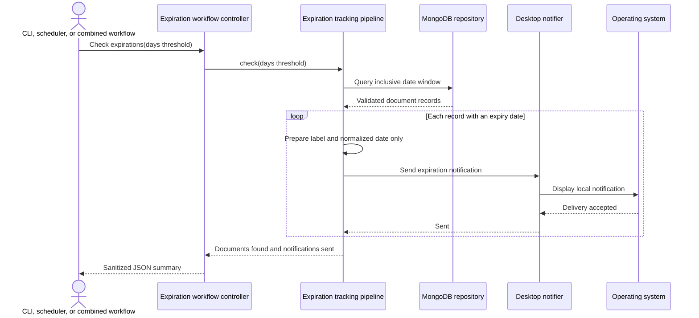

# Architecture

## Purpose and status

Smart Doc Tracker is a local document-processing application organized around typed
domain models, narrow interfaces, infrastructure adapters, and orchestration
pipelines. Both the command-line interface and the FastAPI dashboard are implemented.

## System context



All arrows represent communication on the same host. No application workflow is
designed to call a remote service.

## Package responsibilities

| Package | Responsibility |
| --- | --- |
| `models` | Validated domain data and RAG result types |
| `interfaces` | Narrow protocols for replaceable dependencies |
| `core` | OCR, PDF extraction, hashing, and parsing logic |
| `infrastructure` | Local Ollama adapters and transport validation |
| `db` | MongoDB repositories and ChromaDB vector indexing |
| `notifier` | Delivery of already prepared local notifications |
| `pipeline.py` | Cross-component sequencing and workflow error policy |
| `controllers` | CLI use-case coordination and presentation decisions |
| `cli` | Argument parsing, dependency assembly, and JSON serialization |
| `inbox.py` | Supported-file discovery and collision-safe archiving |
| `mutation_pipeline.py` | Coordinated MongoDB/ChromaDB confirmation, update, and deletion |
| `scheduler.py` | Daily foreground scheduling |
| `web` | FastAPI routes, durable jobs, schemas, templates, and static assets |

Domain models do not depend on MongoDB, ChromaDB, HTTP, or the CLI. Infrastructure
adapters implement protocols from `interfaces` and are passed into workflows
explicitly.

## Component diagram

The following diagram shows the current implemented architecture. The dependency
arrows between application components point toward the component being used. The
dashed arrows show adapters implementing the narrow contracts consumed by the
pipelines.



Every resource in the bottom group is local to the host. In particular, the Ollama,
MongoDB, and ChromaDB adapters reject or are deployed without non-loopback
application endpoints.

## Document ingestion flow

1. The caller supplies a regular local file with an allow-listed extension.
2. Images are read by Pillow and Tesseract. PDFs are read page by page by PyMuPDF;
   pages without usable text use local OCR.
3. Extracted text is sent to an explicitly loopback-only Ollama endpoint.
4. Generated JSON is sanitized, checked for duplicate keys, and validated as
   `DocumentData`.
5. The source file is hashed with SHA-256.
6. MongoDB inserts the validated record only if that hash is new. Long-PDF section
   records are upserted separately.
7. ChromaDB receives local embeddings for raw-text chunks, the summary, and the
   complete structured record.
8. Inbox processing archives a successfully handled file under `data/processed`.
   A failed file remains in the inbox.

MongoDB and ChromaDB do not form a distributed transaction. A vector-index failure
after MongoDB insertion can therefore leave a stored document without a complete
index. Operational reconciliation is a required future capability.

### Single-document processing sequence

Optional blocks correspond to the `--structured` and `--store` CLI switches. PDF
pages use their text layer when it is usable and fall back to Tesseract locally when
needed.



### Inbox processing sequence

Each supported file is isolated from the others. A file is archived only after the
processing pipeline, persistence, and any configured indexing have all completed.



## Query and expiration flows

For general questions, the application embeds the question locally, retrieves the
nearest Chroma fragments, and asks Ollama to produce a validated answer referencing
only retrieved document IDs. Calendar-year expiration questions use normalized
MongoDB dates directly and do not depend on semantic retrieval.

Expiration checks use the locally persisted default reminder for documents that
inherit it and a validated per-document override where present. The notifier receives
only a prepared document label and normalized expiry date; it does not receive OCR
text or the dynamic payload.

### Document-question sequence

Calendar-year expiration questions deliberately bypass semantic retrieval and use
normalized dates. Other questions follow the local retrieval-augmented generation
path.



### Expiration-check sequence

The same check can be invoked once by the CLI, periodically by the foreground daily
scheduler, or after inbox processing in the combined workflow.



## FastAPI application

FastAPI is an inbound adapter over the same application services, not a place
for OCR, persistence, or business rules. The browser and API server must bind to
loopback by default.

The implemented web modules are:

```text
src/smart_doc_tracker/
├── mutation_pipeline.py # coordinated persistence/index mutations
└── web/
    ├── app.py           # composition root and local HTTP routes
    ├── jobs.py          # durable single-worker upload processing
    ├── index_jobs.py    # durable metadata-index refreshes
    ├── pending.py       # durable review staging
    ├── schemas.py       # browser-safe response schemas
    ├── templates/       # server-rendered dashboard shell
    └── static/          # local CSS and JavaScript modules
```

Document upload returns a local job identifier. Durable states progress through
`queued`, `extracting`, `parsing`, `awaiting_confirmation`, or `failed`. Job manifests
contain identifiers, sanitized filenames, language, timestamps, status, and a local
queue filename, but no OCR text. Pending-confirmation manifests contain the raw text
and validated data required to complete indexing after restart.

The implemented application surface includes:

- upload a supported document and inspect processing status;
- list, filter, and view validated document records;
- query exact dynamic fields;
- show in-app expiration notices without placing sensitive fields in browser logs;
- review, edit, confirm, or reject parsed uploads before persistence;
- update metadata and durably refresh summary and structured index fragments;
- inspect indexed content without returning embeddings;
- delete active-collection fragments, MongoDB sections, and the primary record through
  one coordinated mutation service.

RAG questions, pagination, bulk reconciliation, multi-collection deletion, and
archived-source deletion remain outside the current dashboard scope. Mutation
operations use snapshots and compensating actions, but cross-store atomicity is not
available and incomplete compensation still requires operator intervention.

## Dependency and deployment boundaries

The current Docker Compose deployment runs MongoDB and ChromaDB with named volumes
and host ports bound to `127.0.0.1`. Ollama and Tesseract are host dependencies. The
FastAPI server is a host process bound to `127.0.0.1` by default, keeping access to
Tesseract, Ollama, and managed folders explicit.

Running multiple API workers is not supported until job ownership, scheduler
leadership, and concurrent deletion/indexing semantics are designed. One local
application process is the safe default.

## Related decisions

- [ADR 0001: Offline-first architecture](adr/0001-offline-first.md)
- [ADR 0002: Hybrid document schema](adr/0002-hybrid-document-schema.md)
- [ADR 0003: Local persistence](adr/0003-local-persistence.md)
- [ADR 0004: Local RAG](adr/0004-local-rag.md)
